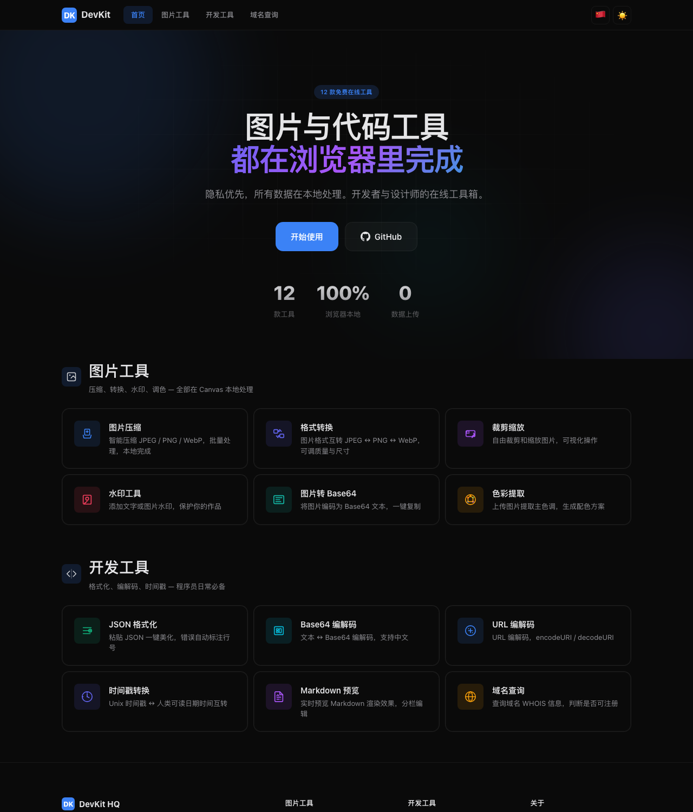

# DevKit HQ

> **12 free online tools for images and code — all running locally in your browser.**  
> 12 个免费在线工具，图片与代码处理，全部在浏览器本地完成。

**[→ Open the site](https://devkithq.vercel.app)**

[](https://devkithq.vercel.app)
[](LICENSE)
[](.)
[](.)



No signup, no uploads, no tracking. Images are processed with the Canvas API on your own machine — nothing is ever sent to a server.

## Tools

### Image tools

| Tool | What it does |
|---|---|
| [Image Compress](https://devkithq.vercel.app/tools/compress.html) | Smart JPEG / PNG / WebP compression, batch processing |
| [Format Convert](https://devkithq.vercel.app/tools/convert.html) | Convert between JPEG, PNG and WebP with quality and size control |
| [Crop & Resize](https://devkithq.vercel.app/tools/resize.html) | Interactive visual crop and resize editor |
| [Watermark](https://devkithq.vercel.app/tools/watermark.html) | Add text or image watermarks |
| [Image to Base64](https://devkithq.vercel.app/tools/img-base64.html) | Encode images to Base64 text, one-click copy |
| [Color Palette](https://devkithq.vercel.app/tools/palette.html) | Extract dominant colors and generate palettes |

### Developer tools

| Tool | What it does |
|---|---|
| [JSON Formatter](https://devkithq.vercel.app/tools/json-formatter.html) | Instant formatting with error highlighting |
| [Base64 Codec](https://devkithq.vercel.app/tools/base64-codec.html) | Encode / decode text, Unicode-safe |
| [URL Codec](https://devkithq.vercel.app/tools/url-codec.html) | `encodeURI` / `decodeURI` with live preview |
| [Timestamp](https://devkithq.vercel.app/tools/timestamp.html) | Unix timestamps ↔ human-readable dates |
| [Markdown Preview](https://devkithq.vercel.app/tools/markdown.html) | Live split-pane Markdown editor |
| [Domain Lookup](https://devkithq.vercel.app/tools/domain-lookup.html) | RDAP / WHOIS lookup for 20+ TLDs |

## Highlights

- **Privacy first** — no uploads; image work happens entirely client-side
- **Zero build step** — plain HTML, CSS and JavaScript; edit a file, refresh, done
- **Bilingual** — full 中文 / English UI with a one-click language switch
- **Fast** — static assets served from the Vercel edge, vendor libraries self-hosted
- **No dependencies at runtime** — no framework, no npm install to run it

## Tech stack

| Layer | Choice |
|---|---|
| Frontend | Vanilla JavaScript, Canvas API, CSS |
| Markdown | [marked.js](https://github.com/markedjs/marked) (self-hosted, no CDN) |
| Hosting | Vercel (static) |
| Serverless | One function — `api/domain-lookup.js`, queries public RDAP registries |
| Analytics | Vercel Analytics |

## Run locally

No toolchain required:

```bash
git clone https://github.com/peichendev/devkithq.git
cd devkithq
python3 -m http.server 8000
# open http://localhost:8000
```

The Domain Lookup tool needs the serverless function; everything else works from the static server.

## Project structure

```
.
├── index.html              # landing page with all 12 tools
├── tools/                  # one standalone page per tool
├── css/                    # shared styles
├── js/
│   ├── shared.js           # i18n, navigation, shared helpers
│   └── vendor/             # marked.js
├── assets/
├── api/
│   └── domain-lookup.js    # RDAP lookup (Vercel function)
└── vercel.json             # routing + cache headers
```

## Deployment

Import the repository into Vercel — no build command, no output directory, no environment variables. `vercel.json` handles routing and cache headers.

## Contributing

Ideas and fixes are welcome. Each tool is a single self-contained HTML file, so adding one means:

1. Create `tools/<name>.html` following the structure of an existing tool
2. Add the card and translations to `index.html` / `js/shared.js`
3. Open a PR

Please keep tools client-side and dependency-free.

## License

[MIT](LICENSE) © 2026 DevKit HQ
